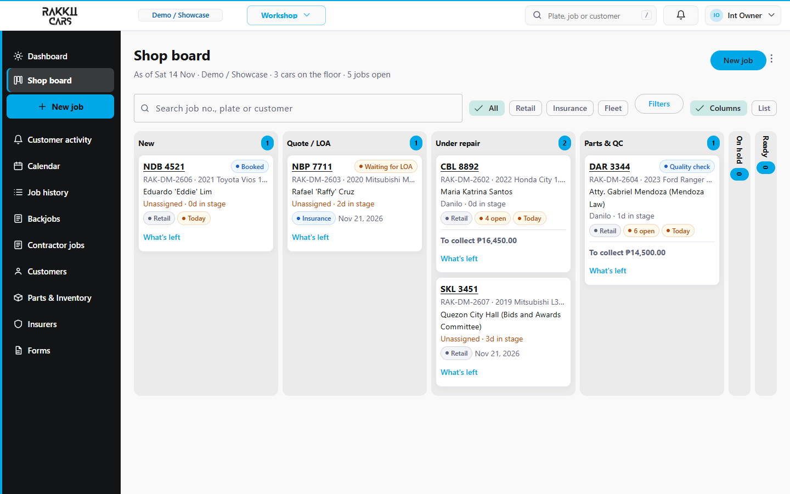
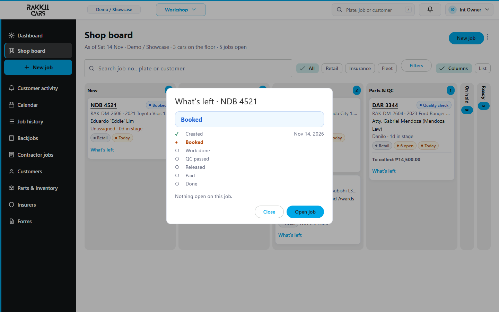
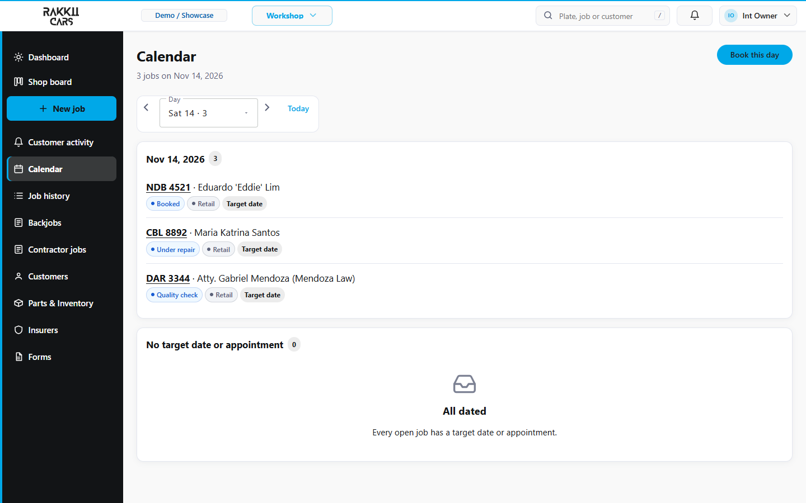
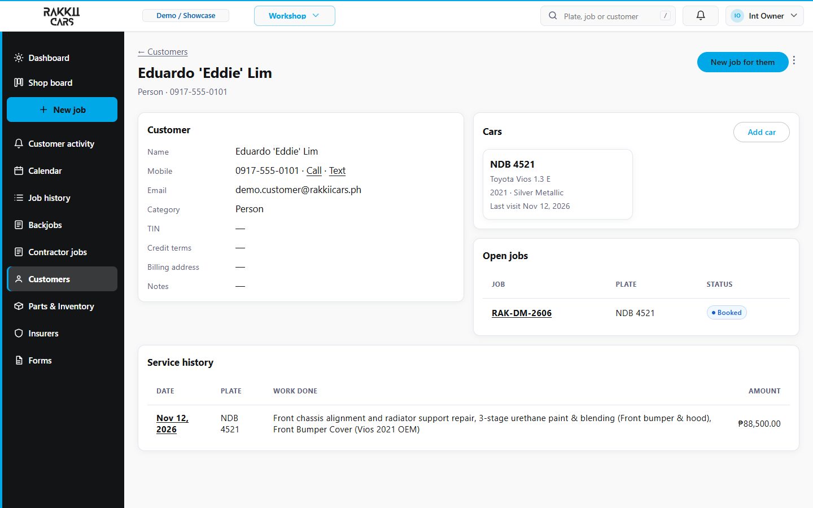

# Board, calendar & search

**Who:** Owner or admin · **Hub:** Workshop

Four screens for seeing every car at once.

## Shop board

**Workshop › Shop board** shows every car in play, in columns: **New**, **Quote / LOA**, **Under repair**, **Parts & QC**, **On hold** and **Ready**.

- Filter with **All**, **Retail**, **Insurance** or **Fleet**, or **Filters** for more.
- Press **List** for a table instead of columns.
- Press **What's left** on a card to see the job's steps and what's still open. **Open job** takes you there.

## Calendar

**Workshop › Calendar** lists the cars due each day (by target date or appointment). Use **Today** and the arrows to move between days. **No target date or appointment** lists open jobs with neither, so nothing is forgotten. **Book this day** starts a job for that day.

## Customer activity

**Workshop › Customer activity** shows what customers did on their pay link: approved or declined an estimate, or sent a payment proof. **Unseen** shows the new ones; press **Mark all seen** when you've dealt with them. The bell in the top bar shows the count.

## Job history and customers

- **Workshop › Job history**: finished jobs. Search by plate, customer or job number, and filter by date, type and status. **Released · not done** means the car is out but something is still open.
- **Workshop › Customers**: every customer with their cars, last visit and open jobs. Open one to see their **Service history**, or press **New job for them**.

## Backjobs

**Workshop › Backjobs**: cars that came back for the same problem, grouped **By responsible**, with what's **Still open**. See [Board, calendar, backjobs & contractors](/reference/10-workshop-operations-board-calendar-backjobs-contractors).
