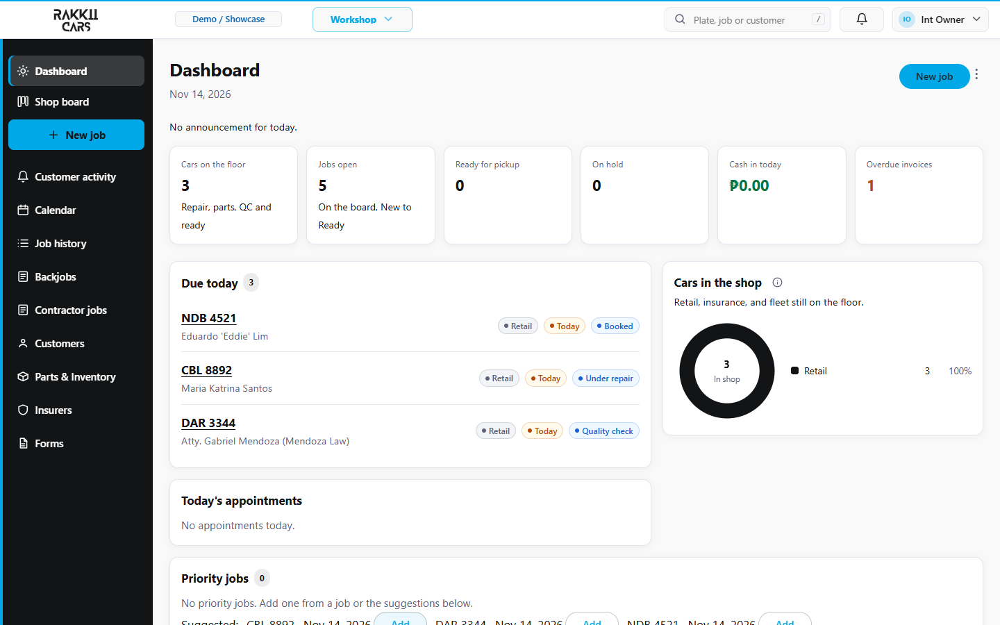

# Your day at the desk

**For:** Owner (and admin) · **You use:** every hub

The desk runs each job from booking to release, and keeps the money, people and settings in order. This page is your daily routine. The [8 job steps](/desk/job/01-open-a-job) cover one car from start to finish.

## Morning: see what needs you

1. **Workshop › Dashboard** (your home page). Read the announcements, then **Priority jobs** and the five numbers: **Cars in shop**, **Ready for pickup**, **On hold**, **Cash in today** and **Overdue invoices**.
2. **Workshop › Shop board**. Every car in play, by status. Press **What's left** on a card to see what's still open without leaving the board.
3. **Workshop › Customer activity**. Customers who approved or declined an estimate, or sent a payment proof, since you last looked. The bell in the top bar shows the count.

## During the day: move each car along

Open a job and press its blue **next-step button**. It always names the next thing to do and takes you there. The full path:

| Step | You do | Status after |
|---|---|---|
| [1. Open a job](/desk/job/01-open-a-job) | **New job**: customer, car, work | **Booked** |
| [2. Add work and save the quote](/desk/job/02-work-and-quote) | Work lines, then **Save quote** | **Quoted** |
| [3. Get the customer's OK](/desk/job/03-customer-approval) | Send the estimate link; take the deposit if needed | **Quoted** |
| [4. Assign and start work](/desk/job/04-start-work) | Pick the technician, **Approve and start work** | **Under repair** |
| [5. QC and ready for pickup](/desk/job/05-qc-and-ready) | Technician sends to QC and takes 4 photos; you mark ready | **Ready for pickup** |
| [6. Bill and collect](/desk/job/06-bill-and-collect) | **Bill customer**, **Record payment** | (no change) |
| [7. Release the car](/desk/job/07-release) | "Can the car leave?", tick the checks, **Release car** | **Released** |
| [8. Mark the job done](/desk/job/08-mark-done) | Check nothing is left, **Mark as done** | **Done** |

Insurance and corporate jobs add a step or two: see [Insurance jobs](/desk/insurance-jobs) and [Corporate & government jobs](/desk/corporate-jobs).

## Through the day: money that arrives

- **Payment proofs**: customers can upload a GCash or Maya screenshot from their pay link. The job shows "The customer uploaded a payment proof that needs checking." Press **Review payment proof**, or open **Finance › Payments**. Check the money arrived before you confirm it.
- **Cash today**: **Finance › Cash** shows the money in and out for the day.

## End of day

- [ ] No car on the board without a next step (holds have a reason)
- [ ] Every payment received today is recorded
- [ ] Payment proofs reviewed
- [ ] Clock kiosk and attendance checked (**HR › Attendance**)

## Weekly and monthly

These are in [Running the shop](/desk/running-the-shop): payroll, payables, parts stock, reports, month close and settings.
