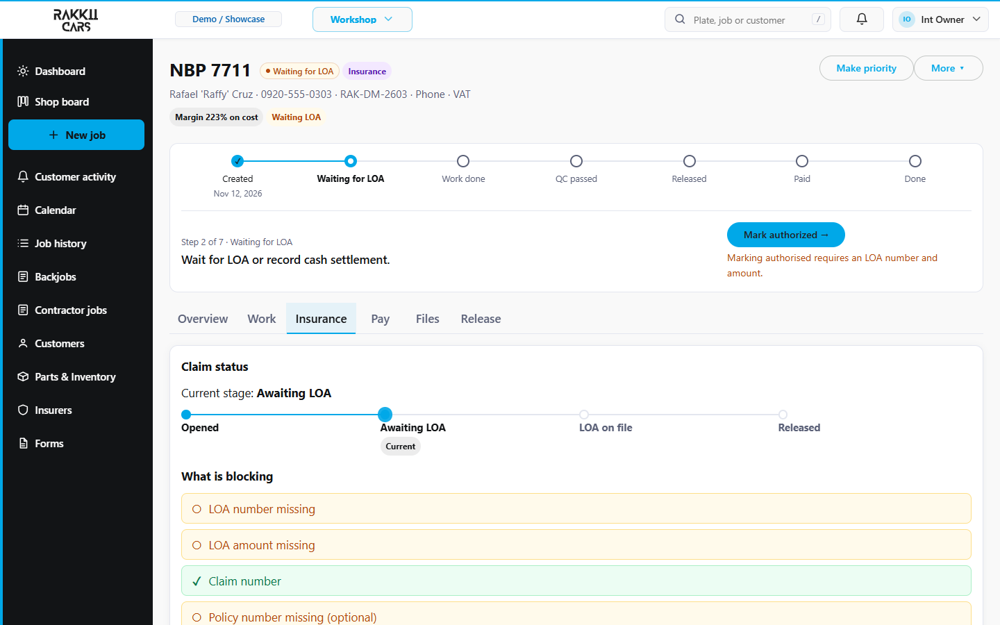

# Insurance jobs

**Who:** Owner or admin · **Adds to:** the [8 job steps](/desk/job/01-open-a-job)

An insurance job has two payers:

- The **insurer** pays what the **LOA** (Letter of Authorization) covers, usually 15–45 days after you bill.
- The **customer** pays their **participation** (deductible) and any extras **before** the car leaves.

```text
Open the job (Insurance) → Quote → Waiting for LOA → Save the LOA → Mark authorized
→ Start work → QC → Bill insurer + Bill customer → Customer pays → Release
→ Insurer pays later → Mark as done
```

## What's different from a normal job

### 1. Open the job as Insurance
On **New job**, set **Job type** to Insurance. Choose the **Insurer** and enter the **Claim number**, **Policy number** and **Adjuster**. The job gets an **Insurance** tab.

New insurer? Add it first in **Workshop › Insurers**.

### 2. Quote, then wait for the LOA
1. Add work lines. Set **Who pays** to **Insurer** for covered work and **Customer** for extras the customer asked for.
2. **Save quote** and print the estimate for the adjuster.
3. Press **Waiting for LOA**.

### 3. Save the LOA
When the insurer's letter arrives:

1. Open the **Insurance** tab, card **Letter of authorization**.
2. Enter the **LOA number**, **LOA date**, **Authorized amount**, **Participation**, any depreciation or betterment, and the insurer's expected pay date. Save.
3. Upload the letter as a PDF on the **Files** tab. Leave **Visible in the customer portal** off.



### 4. Mark authorized, then start work
Press **Mark authorized** (it needs the LOA number and amount), assign the technician and press **Start work**.

::: warning Don't start without an LOA
**Start work (cash / no LOA)** exists for customers paying cash or written insurer approval. It asks for a reason, which is kept in the status log.
:::

**Extra damage found?** Get the insurer's approval, then add it under **Supplements** on the Insurance tab.

### 5. Surrendered parts
The technician logs the replaced parts going back to the insurer in **Surrendered Parts** (or ticks **No parts to surrender**). The release list reminds you.

### 6. Bill both payers
On **Pay › Invoices**, press **Bill insurer ₱…** and **Bill customer ₱…**. The **Summary** shows **Customer owes** and **Insurer owes** separately.

### 7. Collect the customer's share and release
Record the customer's payment (**Who paid**: Customer). The car is held until the customer has paid. It is **not** held for the insurer. Print the **Release of Claim** from the Release tab's **Print ▾** for the customer to sign.

### 8. When the insurer pays
Record it on the job with **Who paid**: Insurer, applied to the insurer invoice. Until then the job shows **Released · not done** and appears in **Finance › Who owes us**. Then **Mark as done**.

More detail: [Insurance claims & LOA (reference)](/reference/06-lane-2-insurance-claims-and-loa).
