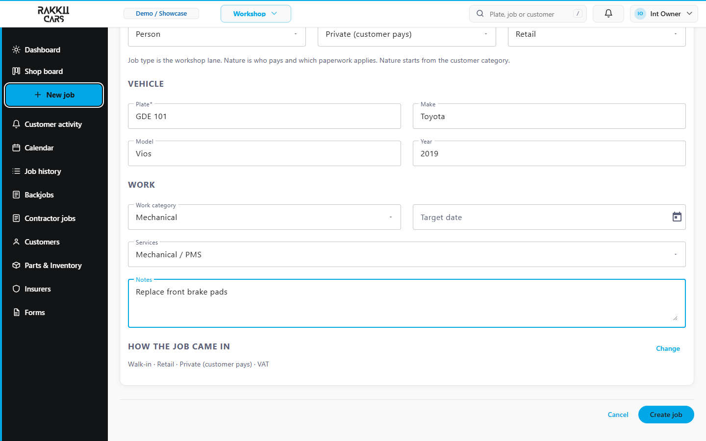
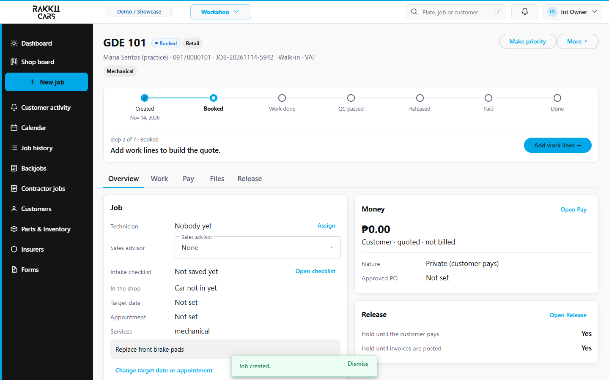

# 1. Open a job

**Who:** Owner or admin · **Where:** Workshop › **New job** · **Status after:** Booked

Name, mobile and plate are enough to open a job. Fill in the rest as you learn it.

## Steps

1. Press **New job** (in the Workshop menu, or on Job history).
2. **Customer**: type the **Customer name**.
   - If they're already on file, the app offers them. Press **Use this customer** (or **Not this customer**).
   - Enter the **Mobile**. Add an **Email** if they have one.
3. **Vehicle**: a returning customer's cars appear as buttons. Tap one, or press **New car** and type the **Plate**, **Make**, **Model** and **Year**.
4. **Work**: choose the **Work category**, set a **Target date** (when it should be done), and describe the **Services** in plain words.
5. **How the job came in** is folded. Press **Change** only if you need to set:
   - **How they arrived** (Walk-in, Phone, Messenger, Website, Sales)
   - **Tax** (VAT or Non-VAT)
   - **Sales advisor** or **Referred by (staff)** (the person who earns commission)
   - An outside agent and their **Agent fee (₱)**
6. Insurance job? Set **Job type** to Insurance; the **Insurance** fields appear (**Insurer**, **Claim number**, **Policy number**, **Adjuster**). See [Insurance jobs](/desk/insurance-jobs).
7. Press **Create job**.

The job opens at **Booked** ("Job created."), with a job number such as `JOB-20261114-5942`. The progress card says "Add work lines to build the quote." Press **Add work lines →**.

## Before you touch the car: intake checklist

For a car left at the shop, fill the intake checklist so damage and belongings are on record:

1. On **Overview**, press **Open checklist** next to **Intake checklist** (or open it from **Files › Documents**).
2. The intake checklist opens over the job.
3. Tap each damaged panel, set the fuel level, mark what's in the car, and save.
4. Print it for the customer to sign.

Picking up or delivering the car? Fill the **Pick-up & delivery waiver** in the same place.

::: tip Car booked for another day?
Set the **Appointment** from **Overview › Change target date or appointment**. The target date is when work should finish; the appointment is when the car comes in.
:::

**Next:** [2. Add work and save the quote](/desk/job/02-work-and-quote)
