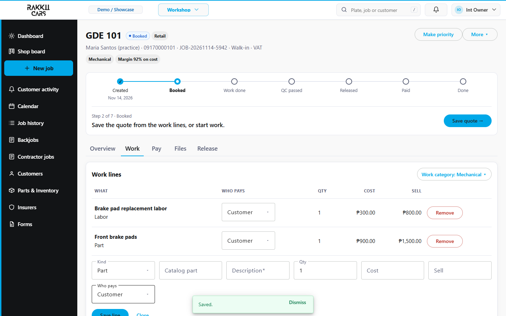
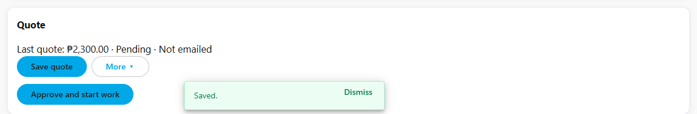
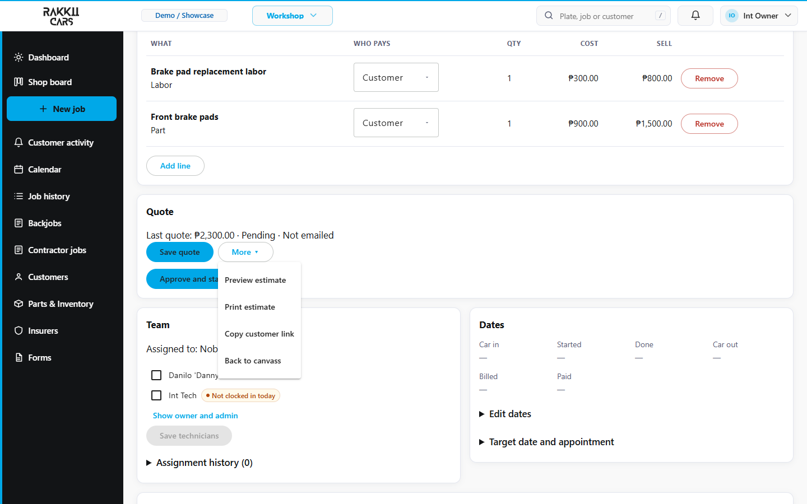

# 2. Add work and save the quote

**Who:** Owner or admin · **Where:** the job's **Work** tab · **Status after:** Quoted

The quote lives on the **Work** tab, right under the work lines. There is no separate Quote tab.

## Add the work lines

1. Open the **Work** tab and press **Add line** on the **Work lines** card.
2. Choose the **Kind**: Labor, Part, Paint, Fee or Other.
   - For a part, pick a **Catalog part** (it shows what's in stock), or leave it empty and just type the description.
3. Enter the **Description**, **Qty**, **Cost** (what it costs the shop) and **Sell** (the customer's price).
4. **Who pays**: Customer. (On insurance jobs, choose **Insurer** for lines the insurer covers.)
5. Press **Save line**. Repeat for each line.

::: tip Need supplier prices first?
Use **More ▾ › Add canvass step** in the job header. A **Canvass** tab appears for collecting supplier quotes. See [Parts, canvass & payables](/reference/09-parts-inventory-canvass-restock-payables).
:::

## Save the quote

1. On the **Quote** card, check the total and the margin chip in the header (for example **Margin 92% on cost**).
2. Press **Save quote**. The app asks "Save the quote?" and reminds you that nothing is sent to the customer yet. Press **Save quote** again.
3. The status becomes **Quoted**, and the card shows the quote, for example "Last quote: ₱2,300.00 · Pending · Not emailed".

**Quote card › More ▾** has:
- **Preview estimate** and **Print estimate**
- **Copy customer link**: the link the customer uses to see and approve the estimate

Press **Email quote** to email the estimate to the customer.

::: tip Quote given by phone or on paper?
Before you save a quote in the app, the job's status buttons include **Mark quoted (sent outside the app)**. Use it when the customer already has a price from you.
:::

## If something stops you

| You see | What to do |
|---|---|
| "Save quote is off: add a work line first." | Add at least one work line. |
| The margin is under the shop's minimum (30% by default) | In warn mode you can still save. In block mode the owner types a **Margin override reason**. |
| A warning that the work lines changed since the last quote | Press **Save quote** again so the customer sees the new total. |

**Next:** [3. Get the customer's OK](/desk/job/03-customer-approval)
