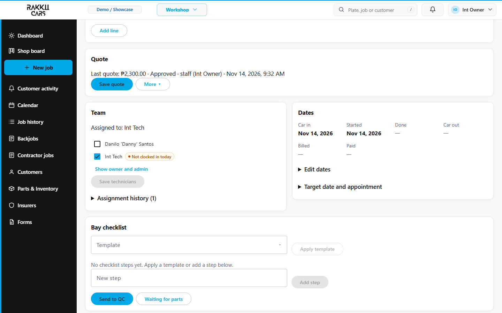
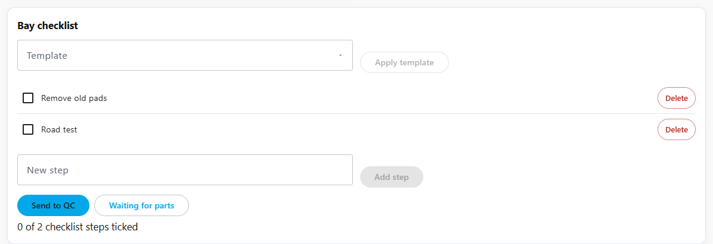
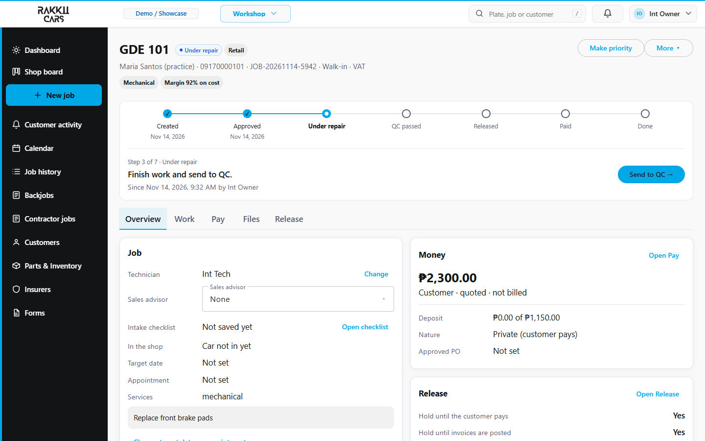

# 4. Assign and start work

**Who:** Owner or admin · **Where:** the job's **Work** tab · **Status after:** Under repair

## Assign the technician

1. On the **Work** tab, find the **Team** card.
2. Tick the technician(s). Owners and admins are hidden; press **Show owner and admin** to see them. Each name shows whether they've clocked in today.
3. Add a **Reason for change** if you like, then press **Save technicians**.

Every change is kept in **Assignment history**.

## Give the technician a checklist

1. Find the **Bay checklist** card.
2. Choose a **Template** and press **Apply template**, or type steps in **New step** and press **Add step**.

The technician ticks these as they work.

## Start work

Press **Approve and start work** on the **Quote** card (or **Start work** on a job with no quote). The status becomes **Under repair**, the progress card says "Finish work and send to QC.", and the job appears on the technician's **My jobs**.

## Dates are filled in for you

The **Dates** card records **Car in**, **Started**, **Done**, **Car out**, **Billed** and **Paid** from what happens on the job. To correct one, press **Edit dates**.

## If something stops you

| You see | What to do |
|---|---|
| The deposit must be paid before work | Record the deposit on **Pay**, or the owner types a reason to start without it. |
| Files tab asks for the usual documents | Fill the intake checklist, or open **Start work without the usual documents** and save a reason. |

**Next:** [5. QC and ready for pickup](/desk/job/05-qc-and-ready)
