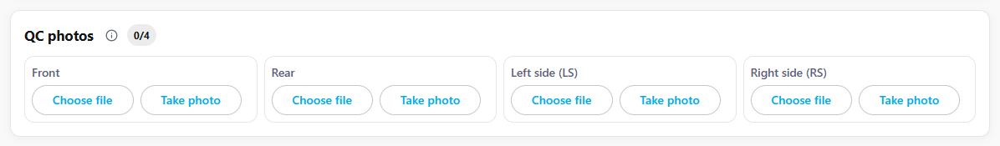

# 5. QC and ready for pickup

**Who:** Technician, then owner or admin · **Where:** the job's **Work** tab · **Status after:** Ready for pickup

## What the technician does

1. Ticks the **Bay checklist**.
2. Presses **Send to QC** on the bay checklist card. The status becomes **Quality check**.
3. Takes the four QC photos: **Front**, **Rear**, **Left side (LS)**, **Right side (RS)**.

The technician guide has the details: [Your day in the bay](/technician/).

## What you do

1. Check the work and the photos (**Show photos** on the **QC photos** card).
2. Press **Ready for pickup** on the **QC photos** card.
3. Not right? Press **Back to shop** to send it back to the bay.

Let the customer know the car is ready.

**Ready for pickup** stays grey until all four photos are in. The progress card names the missing angles, for example "Take the missing QC photos (Front, Rear, Left side (LS), Right side (RS)) before marking ready for pickup. 0 of 4 done."

::: warning No way to take the photos?
Only the owner or admin can skip them:

1. Open the **Release** tab and expand **Release without all QC photos**.
2. Type a **QC override reason** and press **Save QC override**.
3. **Ready for pickup** unlocks. The reason is saved on the job.
:::

**Next:** [6. Bill and collect](/desk/job/06-bill-and-collect)
