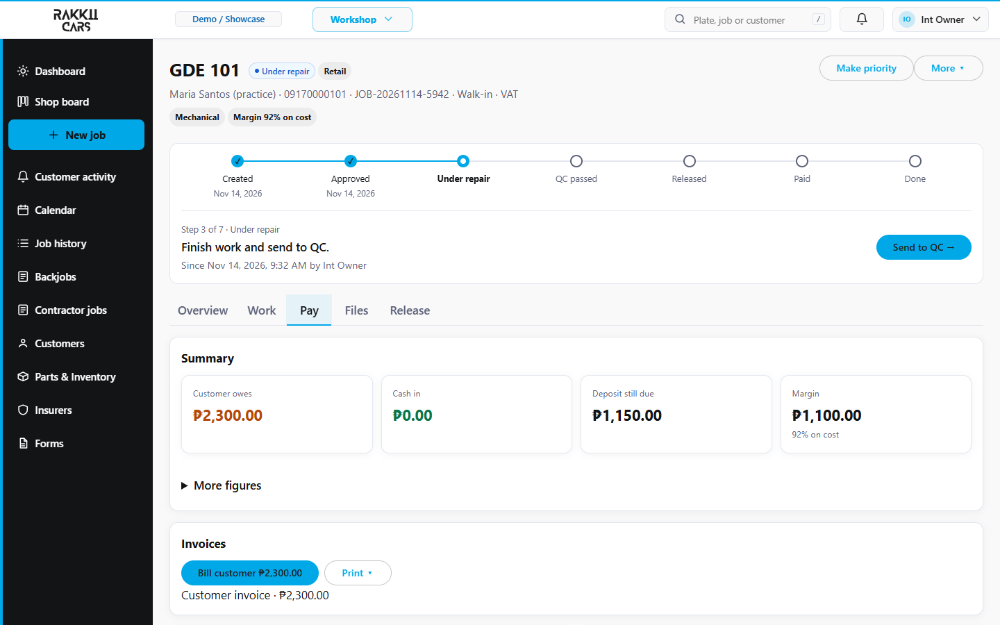
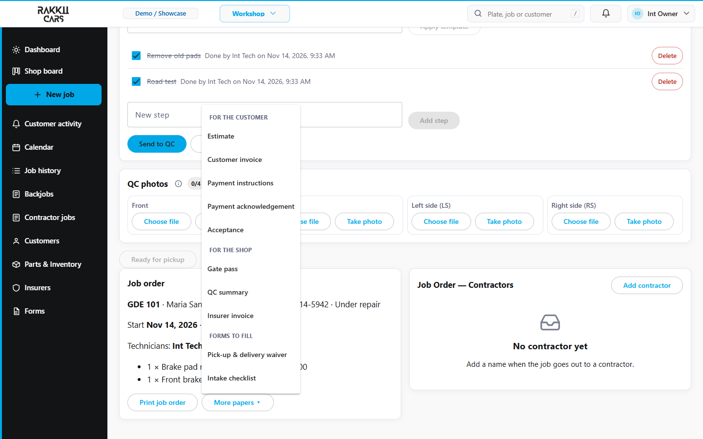
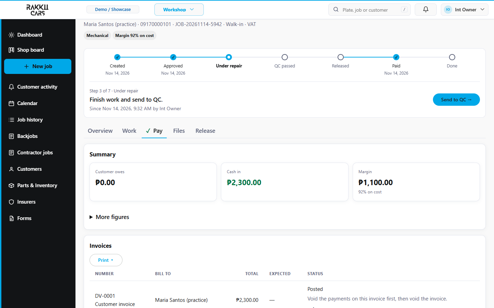

# 6. Bill and collect

**Who:** Owner or admin · **Where:** the job's **Pay** tab · **Status after:** no change

Billing doesn't change the status. It records what the customer owes and what they paid.

## Read the Summary first

The **Summary** card at the top of **Pay** shows **Customer owes**, **Insurer owes**, **Cash in** and **Deposit still due**. Press **More figures** for cost, sell and withholding.

## Post the customer invoice

1. On the **Invoices** card, press **Bill customer ₱…** (the amount of the approved customer lines).
2. The app asks, for example, "Bill the customer ₱2,300.00?" Press **Create invoice**. The invoice is posted with the next number in the VAT or Non-VAT series.
   - Billing before the work is finished? The app warns you may need a credit note if lines change.
3. Print it from **Print ▾**, or from **Work › Job order › More papers**, which has every paper for the job.

::: warning Posting is final
A posted invoice can't be edited. To undo it you need a void or a credit note. See [Fix a mistake](/desk/fix-a-mistake).
:::

## Record the payment

1. Under **Record a payment**, set **Who paid**: Customer.
2. Type the **Amount**, or press the **Fill ₱…** button next to it. While a deposit is still due, **Fill** enters the deposit; after that it enters what's left.
3. Choose the **Method**. For a bank transfer, choose the **Bank account** and fill in **Reference**.
4. Choose the invoice under **Apply to invoice**, and the account in **Deposited to** if you track it.
5. Press **Record payment**. The app asks, for example, "Record ₱2,300.00 from the customer?" Press **Record payment** again.

**Customer owes** should now read **₱0.00**.

::: tip Paid by GCash or Maya from the pay link?
The customer's screenshot shows as a payment proof. Press **Review payment proof** on the Pay tab and confirm it once you've checked the money arrived. Don't record it twice.
:::

By default the car is held until the customer has paid. The owner can change this per job on the **Release** tab (**Release rules**).

**Next:** [7. Release the car](/desk/job/07-release)
