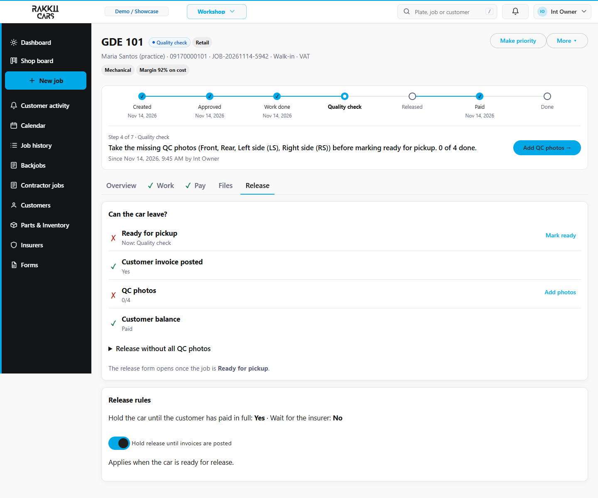
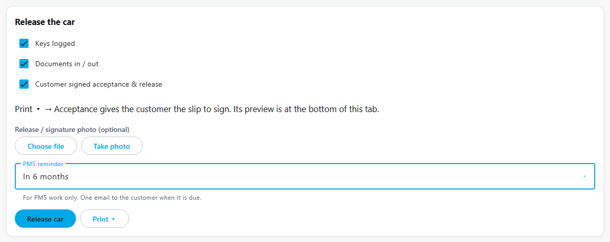

# 7. Release the car

**Who:** Owner or admin · **Where:** the job's **Release** tab · **Status after:** Released

## Check "Can the car leave?"

Open the **Release** tab. The **Can the car leave?** list shows each check with ✓, ✗ or !, and a button that takes you to the fix:

| Check | If it's not done, press |
|---|---|
| **Ready for pickup** | **Mark ready** |
| **Customer invoice posted** | **Bill on Pay** |
| **QC photos** (4/4) | **Add photos** |
| **Customer balance** | **Record payment** |
| **Deposit before release** | **Record payment** |
| **Surrendered parts** (insurance jobs) | **Log parts** |

For example, in the picture below the car isn't ready and the photos are missing, but the invoice is posted and the customer has paid.

## Release

The release form opens once the job is **Ready for pickup**.

1. Print what you need from **Print ▾**: **Gate pass** for the guard, **Acceptance** for the customer to sign, and the **Customer invoice**.
2. Tick the three checks:
   - **Keys logged**
   - **Documents in / out**
   - **Customer signed acceptance & release**
3. Optional: add a **Release / signature photo**.
4. **PMS reminder**: for maintenance work, choose **In 3 months**, **In 6 months** or **In 12 months**. The customer gets one reminder email when it's due. Otherwise leave it at **None**.
5. Press **Release car**. The app asks "Release GDE 101? The car leaves the shop." Press **Release car** again.

The job becomes **Released** ("Car released."). The **Released** card shows who released it and when, the three checks, and the PMS reminder date.

::: tip Rakkii's hand-over routine
Before ticking **Customer signed acceptance & release**, make sure the customer signed the acceptance form, the old parts were returned, and the car was washed and vacuumed.
:::

## If something stops you

Only the owner can release past a block, and always with a written reason:

- **Owner override** with an **Override reason**: the customer still owes, or a check isn't ticked.
- **Reason to release before invoices are posted**: when the shop holds release until invoices are posted.

**Next:** [8. Mark the job done](/desk/job/08-mark-done)
