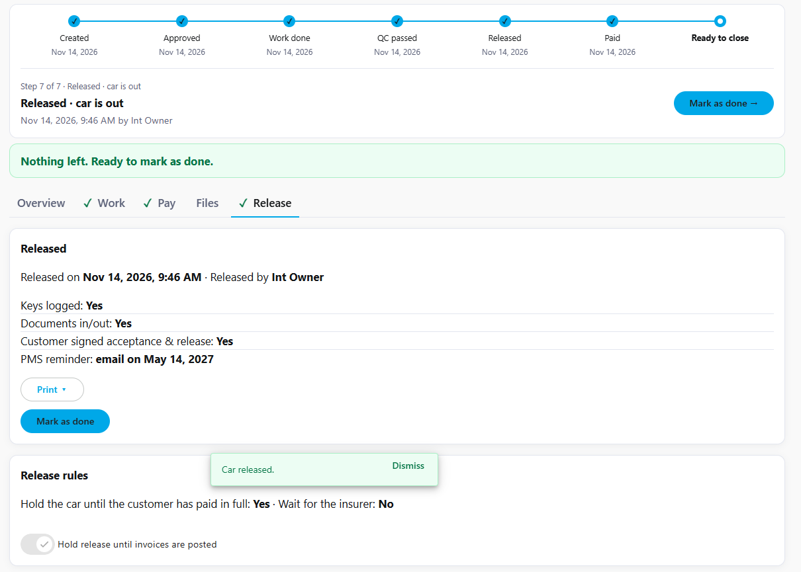
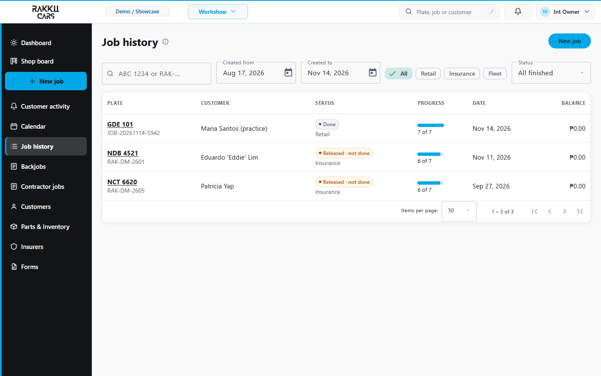

# 8. Mark the job done

**Who:** Owner or admin · **Where:** the job's **Release** tab · **Status after:** Done

A car can leave before everything is settled, for example while an insurer still has to pay. So:

- **Released** means the car is out.
- **Done** means nothing is left on the job.

## Steps

1. Open the released job. The progress card lists anything still open: checklist items, balances, unpaid suppliers or a payment proof to review. When it says **Nothing left. Ready to mark as done.**, you're clear.
2. Press **Mark as done** (on the **Release** tab, or the **Mark as done →** button at the top).
3. The app asks "Mark this job as done?" and reminds you a done job is read-only. Press **Mark as done** again.

The job moves to **Done** and shows in **Workshop › Job history**.

## What blocks it

- **Only open checklist items block Mark as done.** Money still owed is listed but doesn't block, because insurers can pay long after release.
- With checklist items open, only the owner can mark it done, by typing a reason. The reason is saved in the job's **Status log**.

A done job is read-only. It stays in the customer's history and in **Job history**.

## Need to change a released job?

The owner can press **Unlock** in the job header. The old release is kept as history (**Previous release**).

**Back to:** [Your day at the desk](/desk/)
