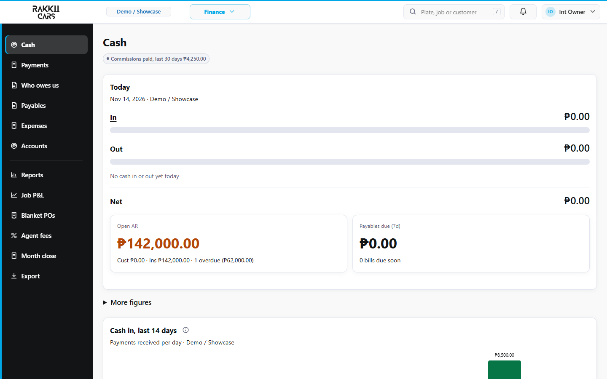
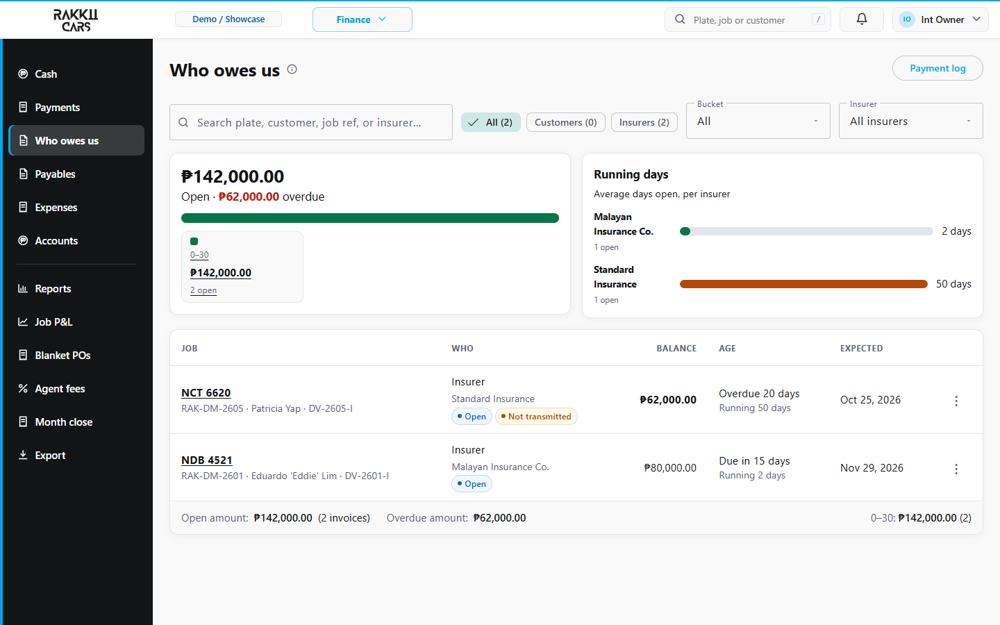
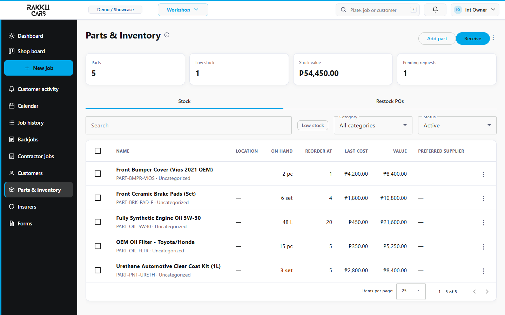
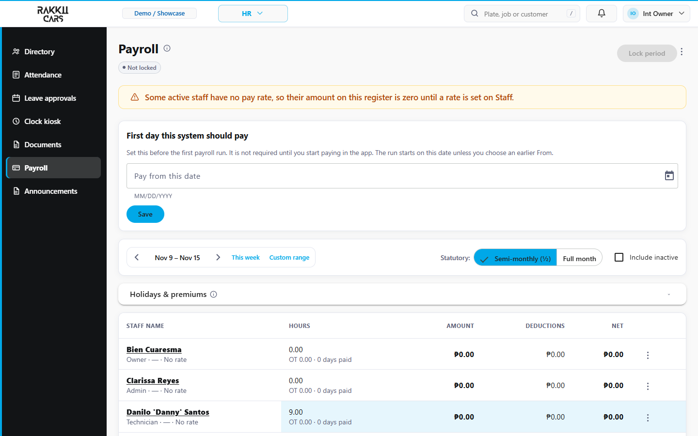
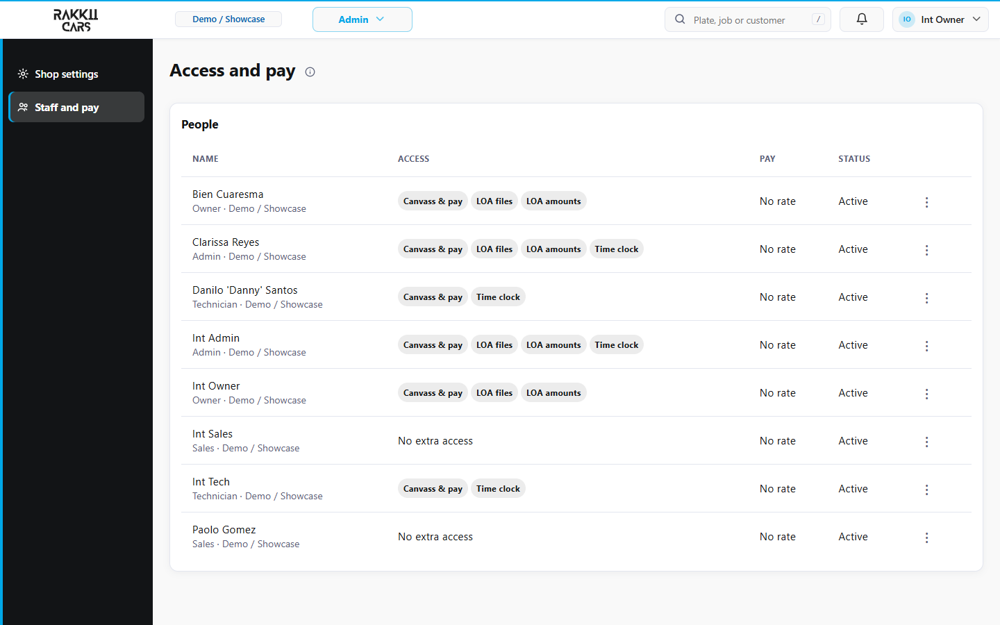
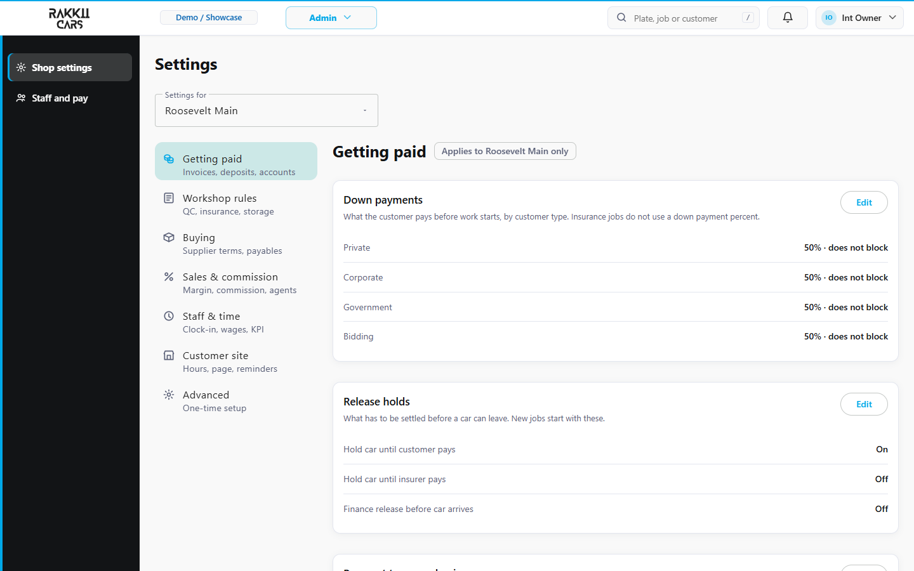

# Running the shop

**Who:** Owner (some pages admin too) · **Hubs:** Workshop, Finance, HR, Admin

The regular jobs that aren't about one car. Each section says where to go and what to do; the reference pages have the full rules.

## Every day

### Check the cash
**Finance › Cash** shows **Today** (money in and out), **Open AR** (what customers and insurers owe) and **Payables due (7d)**.

### Review payment proofs
**Finance › Payments › Pending proofs** lists GCash and Maya screenshots sent from customers' pay links. Check the money arrived, then confirm or reject each one.

### Record expenses
**Finance › Expenses › Add expense** for shop costs that aren't parts for a job (rent, utilities, supplies).

### Attendance
**HR › Attendance** shows everyone's punches. Approve or reject off-site punches and overtime under **OT to approve**. Forgot to clock someone? Use **Punch for…**.

The **Clock kiosk** (**HR › Clock kiosk**) turns a shop tablet into a time clock: staff tap their name.

## Every week

### Who owes us
**Finance › Who owes us** lists every unpaid customer and insurer balance, with its age and expected date. Follow up on the oldest first. Details: [Billing, receivables & credit notes](/reference/08-lane-4-billing-chain-receivables-storage-credit-notes).

### Pay suppliers
**Finance › Payables** groups supplier bills into **Due soon**, **Overdue**, **Open** and **Paid**. Press **Pay** to record a payment.

### Parts stock
**Workshop › Parts & Inventory** shows stock, **Low stock** and the value on hand. Use **Receive** when parts arrive and **Restock POs** to reorder. Details: [Parts, canvass & payables](/reference/09-parts-inventory-canvass-restock-payables).

### Leave requests
**HR › Leave approvals**: decide the requests under **Needs a decision**. When you approve, the app lists the person's open jobs so you can hand them to someone else.

## Every pay period

### Run payroll
1. Open **HR › Payroll** and choose the period (**Semi-monthly (½)** or **Full month**).
2. Check each person's hours, amount, deductions and net. Fix open punches and overtime first in **HR › Attendance**.
3. Press **Save**, then **Lock period** when it's final. Payslips appear in each person's **Me › My payslip**.

Details: [HR, payroll & documents](/reference/11-hr-payroll-kiosk-announcements-documents).

## Every month

### Reports and P&L
- **Finance › Reports**: sales by job type and payer, top accounts and what's owed, for **This month**, **Last month**, **This quarter** or a custom range.
- **Finance › Job P&L**: the **Monthly shop P&L** (revenue, costs, net profit) and the profit on each job.

### Close the month
**Finance › Month close** (owner only). When a month shows **Ready to close**, press **Close month**.

::: danger Closing is final
After a month is closed, money in that month can't be changed. Corrections go into the current month. Close only after every payment, expense and invoice for the month is in.
:::

Details: [Finance & month close](/reference/12-finance-wallets-expenses-agent-fees-pnl-month-close-export).

## Now and then

### Announcements
**HR › Announcements › New announcement** posts a message at the top of everyone's home page.

### Staff and access
**Admin › Staff and pay** lists everyone with their access and pay. Access switches include **Canvass & pay**, **LOA files**, **LOA amounts** and **Time clock**. Add a new person in **HR › Directory** first.

### Shop settings
**Admin › Shop settings** holds the shop's rules, grouped as **Getting paid**, **Workshop rules**, **Buying**, **Sales & commission**, **Staff & time**, **Customer site** and **Advanced**. For example, down payments and release holds are under **Getting paid**. Press **Edit** on a card to change it.

Details: [Shop settings & staff](/reference/13-admin-shop-settings-and-staff-permissions).
