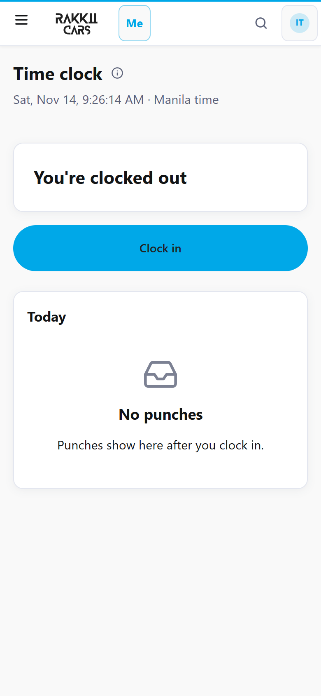
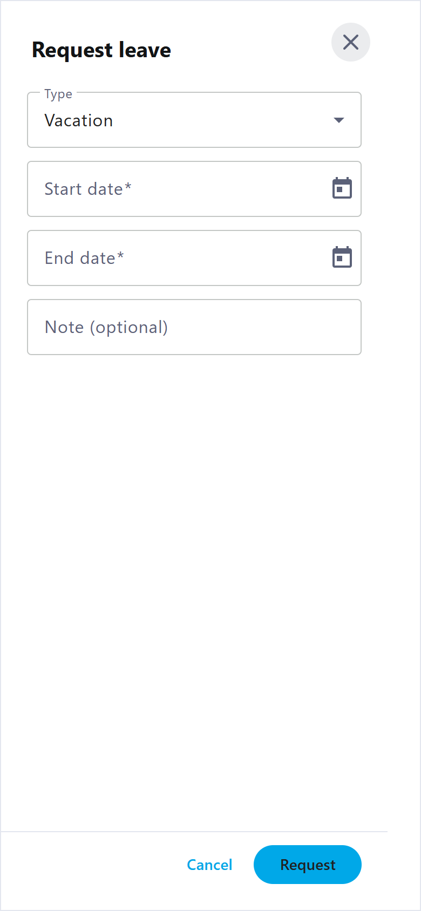
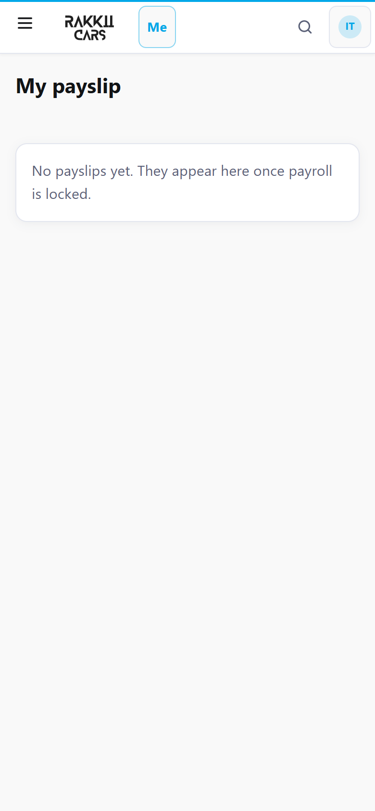

# Me hub: clock, leave, overtime, payslip

**For:** Everyone with a login · **Hub:** Me

The **Me** hub is about you only: your time, your leave and your pay. Nobody else's data shows here.

| Page | Use it to |
|---|---|
| **Time clock** | Clock in and out, and see today's punches |
| **Leave** | Ask for leave and see your balances |
| **My overtime** | File overtime |
| **My payslip** | See your payslips |
| **My commission** | See your commission (only if you have some) |
| **My incentive** | See your quarterly target (sales) |
| **My profile** | See your employee record, documents and scorecards |

::: info Owners
Owners don't clock in or file leave or overtime. Their Me hub has **My payslip** and **My profile** only.
:::

To open the Me hub, press the hub name in the top bar (for example **Workshop ▾**) and choose **Me**.

## Clock in and out

1. Open **Me › Time clock** (technicians can also press **Clock in** on **My jobs**).
2. Take the photo if the shop asks for one.
3. Press **Clock in**. At the end of the day, press **Clock out**.
4. Check your punch under **Today**.

- **Away from the shop?** Type a reason when the app asks. The punch stays **Pending** until the owner approves it, and pending time isn't paid yet.
- **Forgot to clock out?** Tell the owner. They can close the punch with the real time.

## Ask for leave

1. Open **Me › Leave**. Your balances are at the top.
2. Press **Request leave**.
3. Choose the **Type** (Vacation, Sick, Unpaid or Service incentive leave).
4. Pick the **Start date** and **End date**. For half a day, pick the same date for both, then set **Half day** to **Morning (AM)** or **Afternoon (PM)**.
5. Add a **Note (optional)** and press **Request**.

Your request shows under **My requests** as **Pending** until the owner decides. You can cancel it until then. If you have cars due while you're away, tell the desk: the owner sees your open jobs when approving your leave and can hand them to someone else.

## File overtime

1. Open **Me › My overtime**.
2. Press **Request OT**.
3. Enter the **Date**, **Hours** and a **Reason**, then press **File request**.

Overtime is paid only once approved, and never for more hours than you actually punched.

## See your payslip

1. Open **Me › My payslip**.
2. Pick a period to see the pay, deductions and **Net**.
3. Press **Print** for a copy.

Payslips appear only after the owner locks that payroll.

## My profile

Your employee record, documents (press **Download** for a copy) and finalized scorecards. To fix a mistake in your details, ask the owner.
