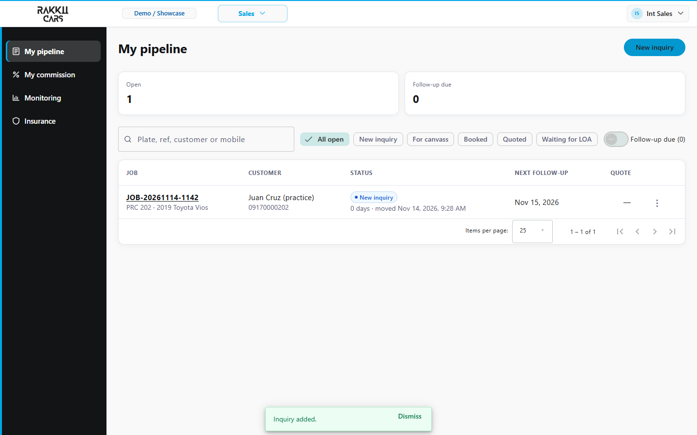
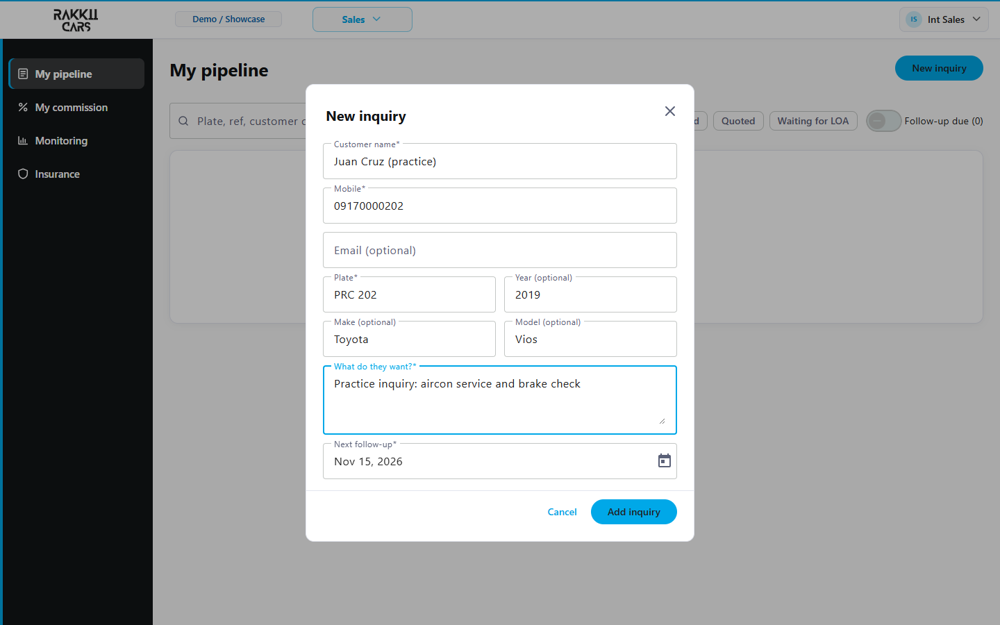
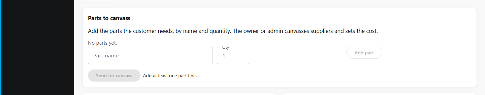
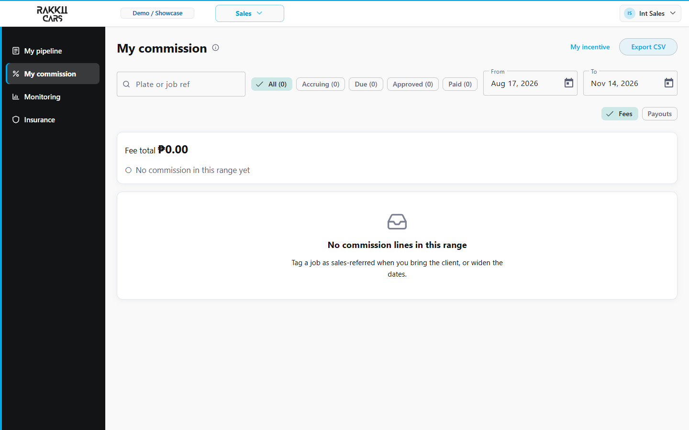
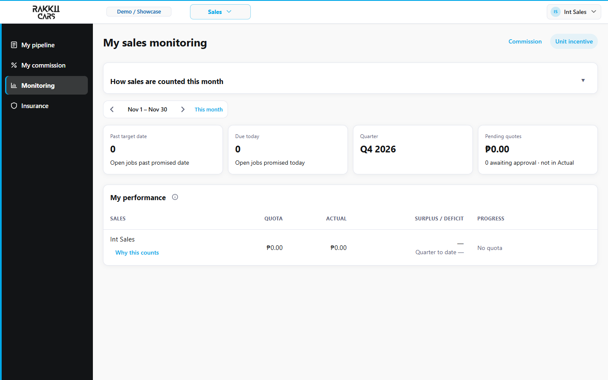
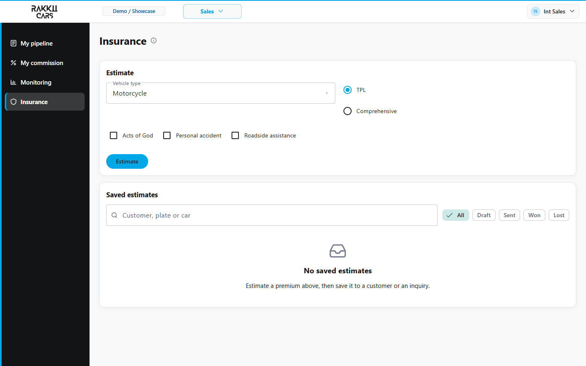

# Your day in sales

**For:** Sales agents · **You use:** the Sales hub and the Me hub

You bring customers in and follow them up until the car arrives. The desk turns your inquiry into a job and runs the repair. You earn commission on customers you referred, once the shop has been paid.

```text
1 Check follow-ups → 2 Log new inquiries → 3 Ask the desk to price parts
→ 4 Follow up → 5 Check your commission
```

## 1. Start with today's follow-ups

1. Open the app. You land on **My pipeline**.
2. Press **Follow-up due** to see who to contact today. The status chips (**All open**, **For canvass**, **Booked**, **Quoted**, **Waiting for LOA**) narrow the list.
3. Call or message those customers first.



## 2. Log a new inquiry

Do this for every customer who calls, messages or walks up to you. Don't use **New job**; that's for the desk.

1. Press **New inquiry**.
2. Fill in **Customer name**, **Mobile** and **Plate**. Add the car's year, make and model if you know them.
3. In **What do they want?**, write the request in plain words, for example "Rear bumper dent, wants an insurance claim with Malayan."
4. Set **Next follow-up**.
5. Press **Add inquiry**. You'll see "Inquiry added."



The inquiry becomes a job at **New inquiry**, with you as the sales advisor. The desk confirms the booking and quotes it.

## 3. Ask the desk to price parts

If the customer needs parts, ask for supplier prices from the job itself:

1. In your pipeline, press the job number (for example `JOB-20261114-1142`) to open the job.
2. On **Overview**, find **Parts to canvass**.
3. Enter each **Part name** and **Qty**, press **Add part**, then **Send for canvass**.
4. Once the canvass is approved, enter the **Sell ₱ (each)** price and press **Save price**.



You can view the job's status and print the estimate, but you can't change its status, work lines or payments.

## 4. Follow up

On each pipeline row:

- **Set follow-up**: pick the next date and add a note.
- **Print estimate**: the customer's estimate (sell prices only).
- **Mark lost**: the customer said no. Give a reason. This only works on **New inquiry** rows.

::: tip Daily habit
Clear **Overdue** every morning before taking new inquiries.
:::

## 5. Check your commission

Open **My commission**. Each line moves through **Accruing → Due → Approved → Paid**.



How it works with the shop's default settings:

| Rule | Default |
|---|---|
| Who earns | The person set as **Referred by (staff)** on the job. The desk sets this. |
| Which job | The customer's first referred job. Repeat visits don't earn again. |
| Rate | 5% of what the customer actually paid |
| Minimum | No commission if the customer paid less than ₱30,000 |
| When | 30 days after release, or after the customer finishes paying if later |

**Example:** your new customer's job is released on March 1 and they paid ₱48,000. You earn 5% × ₱48,000 = **₱2,400**, due March 31.

::: warning Don't see a line?
Only the owner or admin can set **Referred by (staff)**. If you referred a customer and see no line, tell the owner.
:::

## More sales tools

### Monitoring
**Monitoring** shows your monthly **Quota**, **Actual** and **Surplus / deficit**. Insurance jobs count the LOA amount in the LOA's month. Other jobs count the approved PO or quote.



### Insurance premium calculator
**Insurance** gives a customer a quick premium estimate. It's not a policy.

1. Pick the vehicle type, then **TPL** or **Comprehensive**, and any add-ons.
2. Read the estimate.
3. Save it against a pipeline inquiry or a customer name and plate.



### Quarterly incentive
**Me › My incentive** shows your quarterly unit target and progress. The owner records the bonus; it's added to payroll.

### Your clock, leave and payslip
See [Me hub](/me/).
