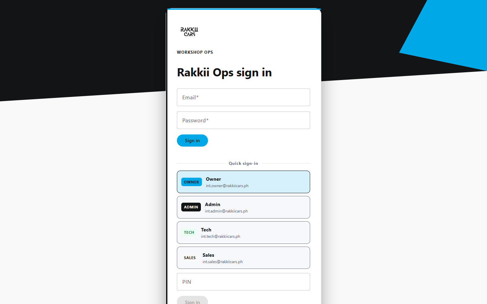
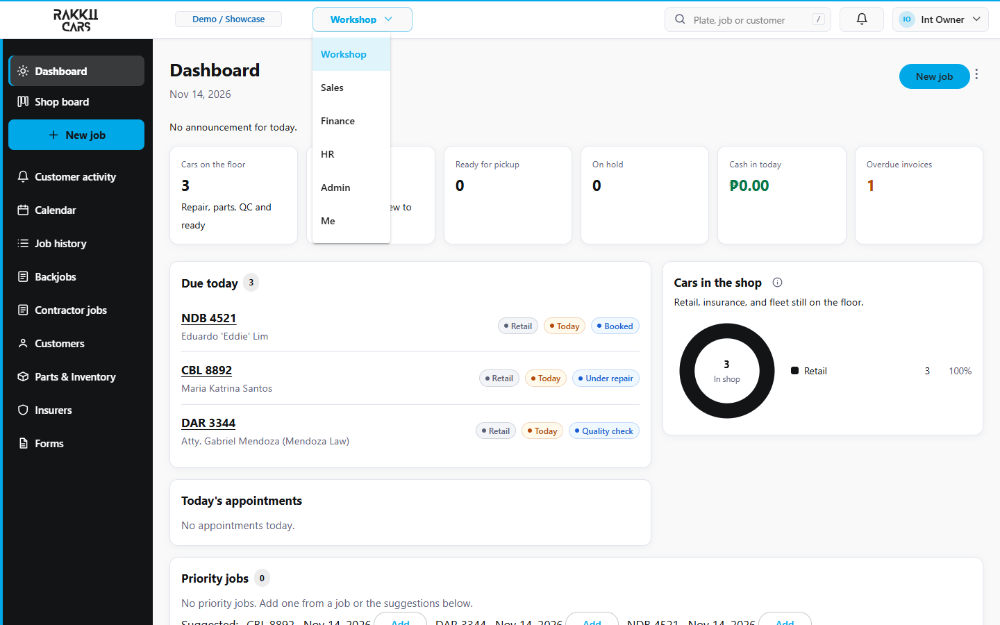
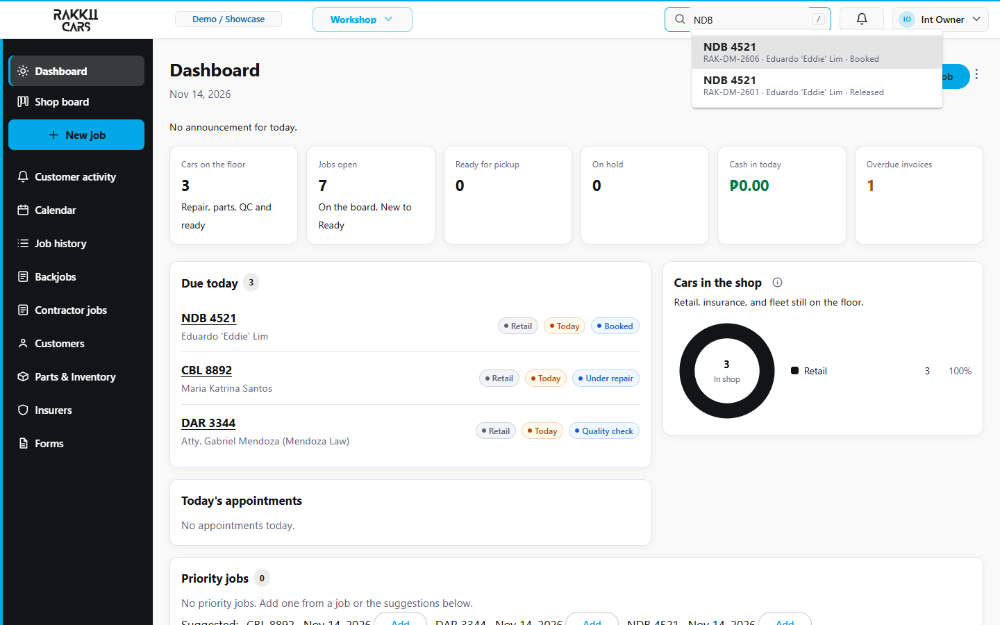
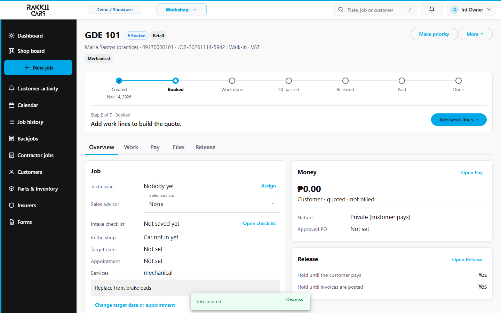

# Getting started

Read this once. It takes about five minutes and covers what every role needs.

## Sign in

1. Open Rakkii Ops in a browser on your phone, tablet or computer.
2. Enter your **Email** and **Password** and press **Sign in**.
3. The app opens your home page:

| Your role | Home page |
|---|---|
| Owner (and admin) | **Workshop › Dashboard** |
| Technician | **Workshop › My jobs** |
| Sales agent | **Sales › My pipeline** |

::: info Practice app only
The integration (practice) app also shows a **Quick sign-in** box with test accounts and a PIN. The live shop app does not have it.
:::

::: warning "Access needed"?
Your login has no role yet, or the page is not part of your role. Ask the owner to check your role in **Admin › Staff and pay**.
:::

## Move around: hubs and menus

The app is split into **hubs**. Press the hub name in the top bar (for example **Workshop ▾**) to switch. Each hub has its own side menu. On a phone, the menu is behind the ☰ button.

| Hub | What's in it | Who sees it |
|---|---|---|
| **Workshop** | Jobs, shop board, calendar, customers, parts, forms | Owner, admin, technician (their jobs only) |
| **Sales** | Pipeline, commission, monitoring, insurance calculator | Owner, admin, sales |
| **Finance** | Cash, payments, who owes us, payables, expenses, reports | Owner, admin |
| **HR** | Staff directory, attendance, leave, payroll, announcements | Owner, admin |
| **Admin** | Shop settings, staff and pay | Owner |
| **Me** | Your clock, leave, overtime, payslip, profile | Everyone |

## Find a job fast

- Type a plate, job number or customer name in the search box at the top (**Plate, job or customer**). Press <kbd>/</kbd> to jump to it from anywhere.
- Or open **Workshop › Job history** to filter by date, type (Retail, Insurance, Fleet) and status.

## The job page in one minute {#job-page}

Every job opens on the same page. From top to bottom:

1. **Header**: the plate, the customer and the status (for example **Under repair**).
2. **Progress card**: seven steps (**Created**, **Booked**, **Work done**, **QC passed**, **Released**, **Paid**, **Done**), a sentence saying what to do now (for example "Add work lines to build the quote."), and one blue **next-step button** such as **Add work lines →** or **Save quote →**. The button opens the right tab and points at the control. If it's grey, the reason is written next to it.
3. **Tabs**: each tab holds one part of the work.

| Tab | What you do there |
|---|---|
| **Overview** | A summary of the job: customer, car, money, release and the status log |
| **Canvass** | Supplier prices for parts (only when the job needs it) |
| **Parts buy** | Buying and receiving parts (only when the job needs it) |
| **Work** | Work lines, the **Quote**, the team, the bay checklist, QC photos and printing |
| **Insurance** | Claim, LOA and supplements (insurance jobs only) |
| **Pay** | What's owed, invoices and payments |
| **Files** | Intake checklist, waiver, photos and documents |
| **Release** | "Can the car leave?" and the release form |

A ✓ on a tab means it's finished. A ● means it needs you. Technicians see only **Work** and **Files** (plus **Canvass** to view).

Other things to know:

- **Hard-to-undo actions ask first.** Saving a quote, posting an invoice, recording a payment and releasing a car each show a confirm box.
- **Printing**: on a computer you get the print dialog. On a phone, the paper is saved as a PDF named after the paper and the plate.
- **More ▾** in the header holds the less common moves: **Put on hold**, **Cancel job**, **No-show**, and editing the car or customer.

## Dark mode

Open your name in the top-right corner and press **Dark mode** (or **Light mode**). The app remembers it on that device.

## Words you will see

| Word | Meaning |
|---|---|
| **Job** | One car visit: the customer, car, work, money and paperwork. |
| **Nature** | Private, Insurance, Corporate, Government or Bidding. It decides the deposit and paperwork rules. |
| **LOA** | Letter of Authorization from an insurer, with the amount they'll pay. |
| **Who pays** | Set on each work line: **Customer** or **Insurer**. |
| **Target date** | When the repair should be done. |
| **Appointment** | When the car is booked to come in. |
| **Released** | The car has left the shop. |
| **Done** | Nothing is left on the job: work, paperwork and checklist are finished. |
| **Margin on cost** | (sell − cost) ÷ cost. A ₱300 part sold at ₱800 is 167% on cost. |
| **Owner override** | The owner lets something through that would normally be blocked. A written reason is always required and saved. |

All dates and times use Manila time.

## Next

- Technician: [Your day in the bay](/technician/)
- Sales agent: [Your day in sales](/sales/)
- Owner or desk: [Your day at the desk](/desk/)
