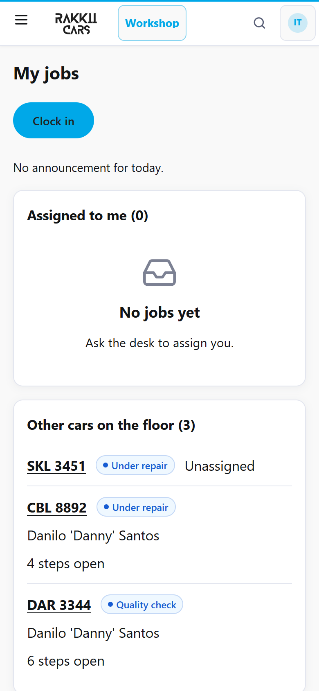
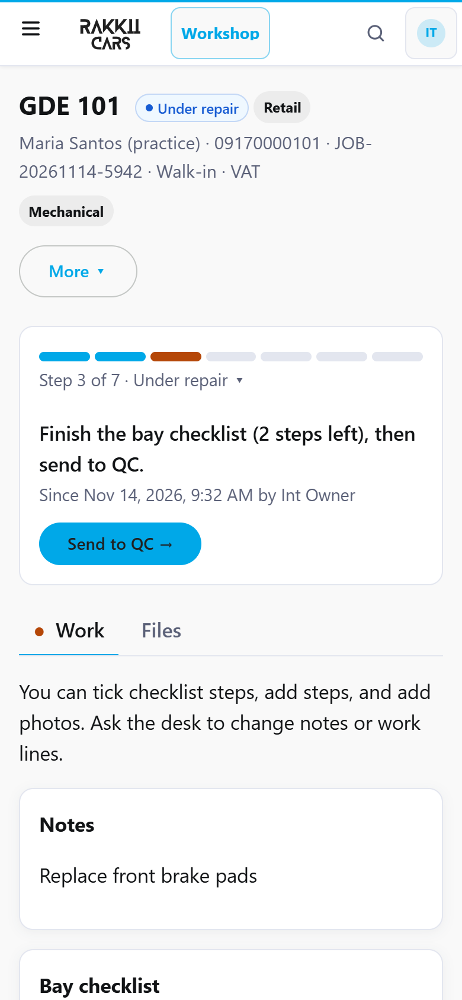
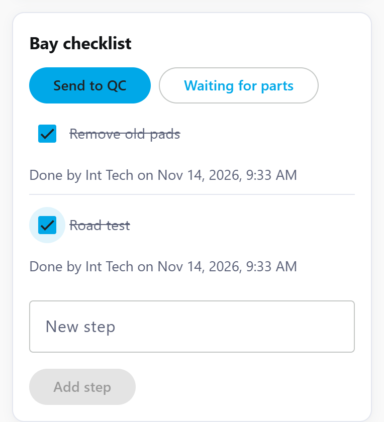
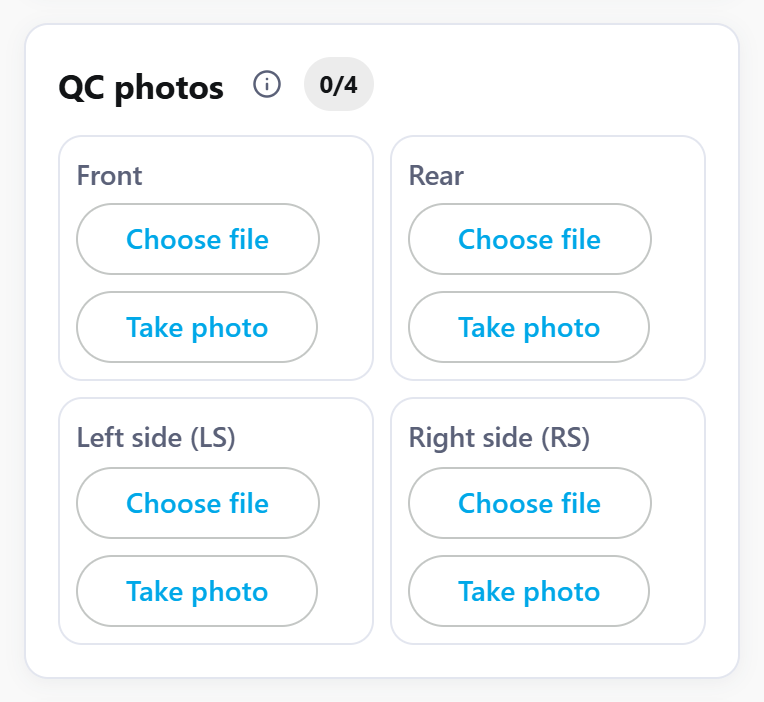

# Your day in the bay

**For:** Technicians · **You use:** Workshop › My jobs, and the Me hub

Your day in six steps. Each step is short; the details under it are only for when you need them.

```text
1 Clock in → 2 Open your job → 3 Tick the checklist → 4 Send to QC
→ 5 Take the 4 QC photos → 6 Clock out
```

## 1. Clock in

1. Open the app. You land on **My jobs**.
2. Press **Clock in** at the top. (You can also use **Me › Time clock**.)
3. If the shop asks for a photo, take it.



::: tip Away from the shop?
On a road test or a parts run, the app warns that you're outside the shop area. Type a reason (for example "Road test on Roosevelt Ave") and clock in anyway. The owner approves it later.
:::

Shop tablet: if the owner runs the **Clock kiosk**, just tap your name on the tablet.

## 2. Open your job

**My jobs** shows:

- **Assigned to me**: your jobs. Tap a plate to open it.
- **Done, waiting for pickup**: cars you finished.
- **Other cars on the floor**: other technicians' jobs. You can look but not change them.

The job opens on the **Work** tab. Read the work lines and **Notes**: they tell you what to do. Prices are hidden from technicians.

The top of the job tells you what to do next, for example "Finish the bay checklist (2 steps left), then send to QC."



::: info "View only: you are not assigned to this job."
You opened someone else's job. Ask the desk to assign you if you need to work on it.
:::

## 3. Tick the bay checklist

1. On the **Work** tab, find **Bay checklist**.
2. Tick each step **when it's really done**. The app saves your name and the time.
3. Missing a step? Type it in **New step** and press **Add step**.
4. Add progress photos with **Other photo** if useful.



## 4. Send the car to QC

When the work is done, press **Send to QC** at the bottom of the **Bay checklist** card.

- If checklist steps are still open, the app asks first. Go back and tick them, or press **Send to QC anyway** if they really don't apply.
- The status changes to **Quality check**.

**Stuck while working?** Use these instead:

| Button | Use it when |
|---|---|
| **Waiting for parts** | You're waiting for an ordered part. Press **Parts in — back to shop** when it arrives. |
| **Put on hold** (in **More ▾**) | Work must stop for another reason. Type why. The desk or you press **Resume** later. |

## 5. Take the four QC photos

The car can't be marked **Ready for pickup** until it has four photos:

**Front** · **Rear** · **Left side (LS)** · **Right side (RS)**

1. On the **Work** tab, find **QC photos**.
2. On each angle, press **Take photo** (or **Choose file** for a photo you already took).
3. Each finished angle gets a ✓ and its buttons disappear. The counter goes from **0/4** to **4/4**.
4. Wrong photo? Use **Replace a photo**.



That's your part done. The desk marks the car **Ready for pickup** and releases it.

## 6. Before you go home

- [ ] Checklist ticked for today's work
- [ ] Waiting cars set to **Waiting for parts**, blocked cars **On hold** with a reason
- [ ] QC photos on every car you finished
- [ ] Insurance jobs: replaced parts logged in **Surrendered Parts** (see below)
- [ ] **Clock out**

## Sometimes

### Insurance jobs: surrendered parts
Insurers often want the damaged parts back. On insurance jobs the **Work** tab has a **Surrendered Parts** card.

1. Press **Add part**.
2. Fill in the part, **Qty**, **Surrender date** and who received it, then save.
3. If nothing goes back to the insurer, tick **No parts to surrender**.

### Canvass and parts buying
Some technicians are allowed to get supplier prices or buy parts. If you are, the job shows a **Canvass** tab. See [Parts, canvass & payables](/reference/09-parts-inventory-canvass-restock-payables).

### Forms and calendar
- **Workshop › Calendar**: which cars are due on which day.
- **Workshop › Forms**: the intake checklist and the pick-up & delivery waiver.

### Leave, overtime and payslips
All in the **Me** hub. See [Me hub](/me/).
